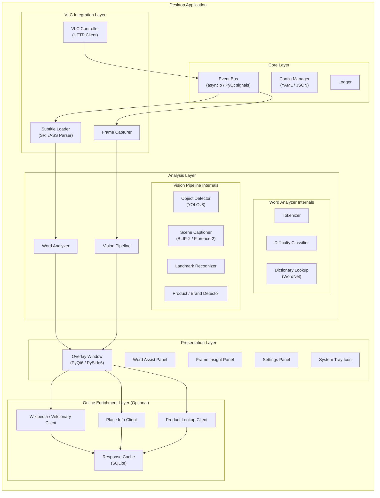
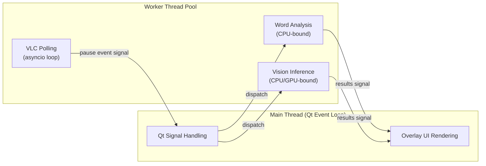
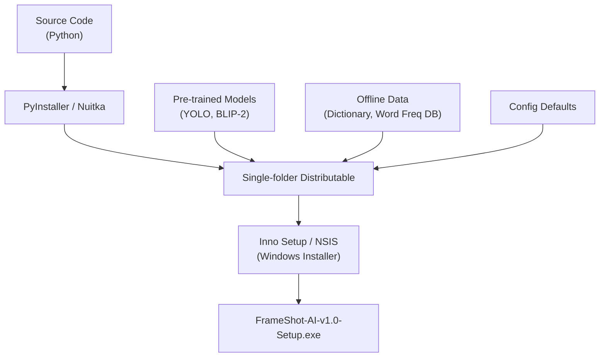

# 🏗️ FrameShot-AI — Software Design Document (Architecture)

**Version:** 1.0  
**Date:** 2026-10-20  
**Status:** Draft  

---

## 1. System Overview

FrameShot-AI is a desktop application that acts as a companion to VLC Media Player. It monitors VLC's playback state, and upon detecting a pause event, performs two parallel analysis pipelines (subtitle word analysis + visual frame analysis) and renders results in a native overlay window.

```
┌─────────────────────────────────────────────────────────────────┐
│                        User's Desktop                           │
│                                                                 │
│  ┌──────────────┐     ┌──────────────────────────────────────┐  │
│  │  VLC Player   │◄───►│          FrameShot-AI                │  │
│  │              │     │                                      │  │
│  │  HTTP :8080  │     │  ┌────────┐ ┌─────────┐ ┌────────┐  │  │
│  │  (interface) │     │  │VLC Ctrl│ │Analyzer │ │Overlay │  │  │
│  │              │     │  │        │ │ Engine  │ │  UI    │  │  │
│  └──────────────┘     │  └────────┘ └─────────┘ └────────┘  │  │
│                       └──────────────────────────────────────┘  │
└─────────────────────────────────────────────────────────────────┘
```

---

## 2. Architecture Style

**Modular Monolith** — All components run in a single process (or a small set of processes) on the user's machine. Modules communicate via in-process function calls and an internal event bus. This keeps deployment simple (single installer) while maintaining clean separation of concerns.

---

## 3. High-Level Architecture



---

## 4. Technology Stack

| Layer | Technology | Rationale |
|-------|-----------|-----------|
| **Language** | Python 3.11+ | Rich ML/AI ecosystem, VLC bindings, rapid prototyping. |
| **GUI Framework** | PyQt6 / PySide6 | Native look-and-feel, transparent/frameless windows, signals/slots for event handling. |
| **VLC Communication** | `requests` (HTTP) | VLC's built-in HTTP interface is the most reliable cross-platform option. |
| **Subtitle Parsing** | `pysubs2` | Mature library supporting SRT, ASS, SSA, MicroDVD formats. |
| **NLP / Tokenization** | `nltk` or `spaCy` (offline) | Word tokenization, stopword filtering, lemmatization. |
| **Word Frequency** | Custom (COCA/BNC word list as SQLite DB) | Classify word difficulty by frequency rank. |
| **Offline Dictionary** | `nltk.corpus.wordnet` / bundled JSON dict | Definitions, synonyms, pronunciation. |
| **Object Detection** | `ultralytics` (YOLOv8-nano/small) | Fast, accurate, runs on CPU. Lightweight variants available. |
| **Scene Captioning** | `transformers` (BLIP-2 / Florence-2) | State-of-the-art image captioning, runs locally with quantization. |
| **Landmark/Product** | CLIP embeddings + local index | Match frame crops against a curated embedding database of landmarks/products. |
| **Database** | SQLite | Settings, cache, vocabulary journal, word frequency index. |
| **Packaging** | PyInstaller / Nuitka | Single-file or single-folder distributable for Windows. |
| **Task Queue** | `asyncio` + `concurrent.futures` | Parallel execution of word analysis and vision pipeline. |

---

## 5. Module Design

### 5.1 VLC Controller (`vlc_controller.py`)

**Responsibility:** Communicate with VLC's HTTP interface to monitor playback state.

```python
class VLCController:
    """Monitors VLC playback state via HTTP interface."""
    
    def __init__(self, host: str = "127.0.0.1", port: int = 8080, password: str = ""):
        ...
    
    async def connect(self) -> bool:
        """Test connection to VLC HTTP interface."""
        
    async def get_status(self) -> PlaybackStatus:
        """Returns current playback status (playing/paused/stopped, timestamp, filename)."""
        
    async def take_snapshot(self, output_path: str) -> Path:
        """Command VLC to save a snapshot of the current frame."""
        
    async def poll_loop(self, interval_ms: int = 500):
        """Main polling loop. Emits events on state changes."""
```

**Data Model:**
```python
@dataclass
class PlaybackStatus:
    state: Literal["playing", "paused", "stopped"]
    timestamp_ms: int           # Current position in milliseconds
    duration_ms: int            # Total duration
    filename: str               # Currently playing file
    subtitle_track: int | None  # Active subtitle track index
```

### 5.2 Subtitle Parser (`subtitle_parser.py`)

**Responsibility:** Load, parse, and index subtitle files for fast timestamp lookup.

```python
class SubtitleParser:
    """Parses and indexes subtitle files for timestamp-based lookup."""
    
    def __init__(self):
        self._entries: list[SubtitleEntry] = []
        self._sorted_starts: list[int] = []  # For binary search
    
    def load(self, filepath: Path) -> None:
        """Load and index a subtitle file (SRT/ASS/SSA)."""
        
    def get_at(self, timestamp_ms: int) -> SubtitleEntry | None:
        """Binary search for subtitle active at given timestamp."""
        
    def auto_detect(self, video_path: Path) -> Path | None:
        """Find matching subtitle file in the same directory."""

@dataclass
class SubtitleEntry:
    index: int
    start_ms: int
    end_ms: int
    text: str            # Raw subtitle text (markup stripped)
    text_original: str   # Original text with formatting
```

### 5.3 Word Analyzer (`word_analyzer.py`)

**Responsibility:** Tokenize subtitle text, classify word difficulty, look up definitions.

```python
class WordAnalyzer:
    """Analyzes subtitle text for hard/uncommon words."""
    
    def __init__(self, difficulty_level: DifficultyLevel = DifficultyLevel.INTERMEDIATE):
        self._freq_db: FrequencyDB       # Word frequency database
        self._dictionary: OfflineDict     # Offline dictionary (WordNet)
        
    def analyze(self, text: str) -> list[WordResult]:
        """Full pipeline: tokenize → filter → classify → lookup."""
        
    def tokenize(self, text: str) -> list[str]:
        """Split text into word tokens, handle contractions."""
        
    def classify_difficulty(self, word: str) -> float:
        """Return difficulty score 0.0 (common) → 1.0 (rare)."""
        
    def lookup(self, word: str) -> DictEntry | None:
        """Offline dictionary lookup."""

@dataclass
class WordResult:
    word: str
    difficulty_score: float
    is_hard: bool
    definition: str | None
    synonyms: list[str]
    pronunciation: str | None     # IPA

class DifficultyLevel(Enum):
    BEGINNER = "beginner"         # Flag top 8000+ words
    INTERMEDIATE = "intermediate" # Flag top 15000+ words
    ADVANCED = "advanced"         # Flag top 30000+ words
```

### 5.4 Vision Pipeline (`vision_pipeline.py`)

**Responsibility:** Analyze captured frame for objects, landmarks, products, and scene description.

```python
class VisionPipeline:
    """Runs visual analysis on captured video frames."""
    
    def __init__(self, model_profile: ModelProfile = ModelProfile.BALANCED):
        self._detector: ObjectDetector
        self._captioner: SceneCaptioner
        self._landmark_db: EmbeddingIndex
        self._product_db: EmbeddingIndex
        
    async def analyze(self, image_path: Path) -> FrameAnalysis:
        """Run full vision pipeline on an image."""
        
    def detect_objects(self, image: np.ndarray) -> list[Detection]:
        """Run object detection (YOLO)."""
        
    def caption_scene(self, image: np.ndarray) -> str:
        """Generate scene description (BLIP-2)."""
        
    def match_landmarks(self, crops: list[np.ndarray]) -> list[LandmarkMatch]:
        """Match object crops against landmark embedding DB."""

@dataclass
class Detection:
    label: str
    category: str          # "object" | "landmark" | "product" | "clothing"
    confidence: float
    bbox: tuple[int, int, int, int]  # x1, y1, x2, y2
    details: str | None

@dataclass
class FrameAnalysis:
    scene_caption: str
    detections: list[Detection]
    landmarks: list[LandmarkMatch]
    products: list[ProductMatch]
    
class ModelProfile(Enum):
    LITE = "lite"           # YOLOv8n only, no captioning — fast, low RAM
    BALANCED = "balanced"   # YOLOv8s + BLIP-2 (int8) — good balance
    FULL = "full"           # YOLOv8m + BLIP-2 (fp16) + CLIP — best quality
```

### 5.5 Overlay Manager (`overlay_manager.py`)

**Responsibility:** Render and manage the overlay window on top of VLC.

```python
class OverlayManager:
    """Manages the overlay window lifecycle and rendering."""
    
    def __init__(self, parent: QApplication):
        self._window: OverlayWindow
        self._vlc_hwnd: int | None  # VLC window handle for positioning
        
    def show(self, word_results: list[WordResult], frame_analysis: FrameAnalysis):
        """Compose and display the overlay with analysis results."""
        
    def hide(self):
        """Hide the overlay (called on VLC resume)."""
        
    def update_position(self):
        """Reposition overlay to match VLC window geometry."""
        
    def toggle(self):
        """Toggle overlay visibility."""
```

---

## 6. Data Flow Architecture

```
VLC HTTP API
    │
    ▼
┌──────────────┐
│ VLC Controller│──── poll every 500ms ────►  Event: PAUSED
│              │                              │
└──────────────┘                              │
                                    ┌─────────┴──────────┐
                                    │                    │
                                    ▼                    ▼
                           ┌──────────────┐    ┌──────────────┐
                           │Subtitle Parser│    │Frame Capturer │
                           │              │    │              │
                           └──────┬───────┘    └──────┬───────┘
                                  │                   │
                                  ▼                   ▼
                           ┌──────────────┐    ┌──────────────┐
                           │Word Analyzer  │    │Vision Pipeline│
                           │              │    │              │
                           └──────┬───────┘    └──────┬───────┘
                                  │                   │
                                  └────────┬──────────┘
                                           │
                                           ▼
                                  ┌──────────────┐
                                  │Overlay Manager│
                                  │  (PyQt6 UI)  │
                                  └──────────────┘
```

---

## 7. Database Schema

### 7.1 Word Frequency Table (Pre-populated)

```sql
CREATE TABLE word_frequency (
    word        TEXT PRIMARY KEY,
    rank        INTEGER NOT NULL,      -- 1 = most common
    frequency   REAL NOT NULL,         -- Normalized frequency
    pos         TEXT                   -- Part of speech
);
```

### 7.2 Dictionary Cache

```sql
CREATE TABLE dictionary (
    word          TEXT PRIMARY KEY,
    definition    TEXT NOT NULL,
    synonyms      TEXT,                -- JSON array
    pronunciation TEXT,                -- IPA string
    pos           TEXT
);
```

### 7.3 Vocabulary Journal

```sql
CREATE TABLE vocabulary_journal (
    id            INTEGER PRIMARY KEY AUTOINCREMENT,
    word          TEXT NOT NULL,
    definition    TEXT,
    context       TEXT,                -- The subtitle line where it appeared
    movie_title   TEXT,
    timestamp_ms  INTEGER,
    saved_at      TIMESTAMP DEFAULT CURRENT_TIMESTAMP
);
```

### 7.4 Online Cache

```sql
CREATE TABLE online_cache (
    cache_key     TEXT PRIMARY KEY,    -- e.g., "wiki:edifice" or "landmark:eiffel_tower"
    source        TEXT NOT NULL,       -- "wikipedia" | "wiktionary" | "product_api"
    response_json TEXT NOT NULL,
    fetched_at    TIMESTAMP DEFAULT CURRENT_TIMESTAMP,
    ttl_seconds   INTEGER DEFAULT 604800  -- 7 days
);
```

---

## 8. Configuration Schema

```yaml
# config.yaml
vlc:
  host: "127.0.0.1"
  port: 8080
  password: ""
  poll_interval_ms: 500

analysis:
  difficulty_level: "intermediate"  # beginner | intermediate | advanced
  confidence_threshold: 0.7        # Vision detection minimum confidence
  model_profile: "balanced"        # lite | balanced | full

overlay:
  opacity: 0.85
  position: "right"               # left | right | bottom | fullscreen
  hotkey: "Ctrl+Shift+F"
  auto_dismiss: true
  theme: "dark"                   # dark | light | auto

online:
  enabled: false                  # Offline-first: disabled by default
  cache_ttl_days: 7
  services:
    wikipedia: true
    wiktionary: true
    product_lookup: false

paths:
  models_dir: "./models"
  database: "./data/frameshot.db"
  word_freq: "./data/word_frequency.db"
  vocab_journal: "./data/vocabulary.db"
```

---

## 9. Concurrency Model



- **Main thread:** Runs the Qt event loop. All UI updates happen here.
- **VLC polling:** Runs in a background thread with an asyncio event loop.
- **Analysis workers:** Word analysis and vision pipeline run in parallel using `concurrent.futures.ThreadPoolExecutor` (or `ProcessPoolExecutor` for CPU-intensive vision tasks).
- **Signals/Slots:** PyQt signals bridge worker threads → main thread safely.

---

## 10. Deployment & Packaging



### Distributable Structure
```
FrameShot-AI/
├── frameshot.exe              # Main executable
├── config.yaml                # User configuration
├── models/
│   ├── yolov8n.pt             # Object detection (~6 MB)
│   ├── blip2-opt-2.7b-int8/   # Scene captioning (~1.4 GB)
│   └── clip-vit-b32/          # Embedding model (~340 MB)
├── data/
│   ├── word_frequency.db      # Pre-populated frequency DB
│   ├── dictionary.db          # Offline dictionary
│   ├── landmarks.index        # CLIP embedding index for landmarks
│   └── products.index         # CLIP embedding index for products
├── resources/
│   ├── icons/
│   └── styles/
└── logs/
```

---

## 11. Security Considerations

| Concern | Mitigation |
|---------|------------|
| VLC HTTP interface exposed on localhost | Default password required; bind to `127.0.0.1` only. |
| Online API calls leak viewing habits | Online mode disabled by default; no telemetry. |
| Model files could be tampered with | Verify SHA-256 checksums on first load. |
| User vocabulary data is private | All data stored locally in user's app data directory; no cloud sync. |

---

## 12. Performance Budget

| Operation | Target Latency | Strategy |
|-----------|---------------|----------|
| VLC status poll | < 50ms | Lightweight HTTP GET to `/requests/status.json` |
| Subtitle lookup | < 5ms | Pre-indexed binary search in memory |
| Word analysis (full line) | < 100ms | Pre-loaded frequency DB + WordNet in memory |
| Frame capture | < 200ms | VLC snapshot command or direct frame read |
| Object detection (YOLOv8n) | < 500ms (CPU) | Nano model; batch size 1 |
| Scene captioning (BLIP-2 int8) | < 1.5s (CPU) | INT8 quantized; lazy-loaded |
| Total pause-to-overlay | < 2s | Subtitle + Vision run in parallel |
