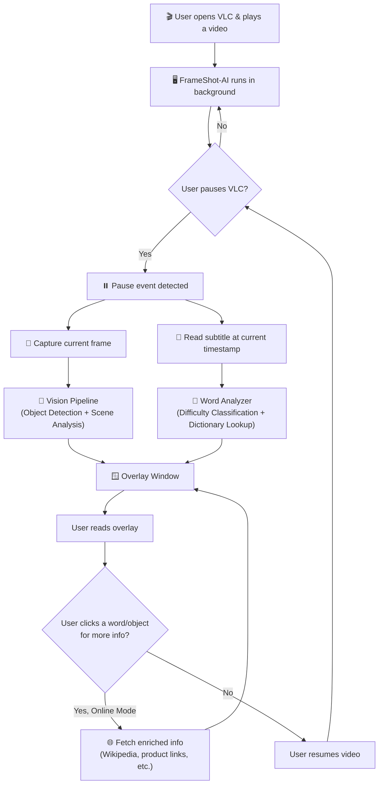
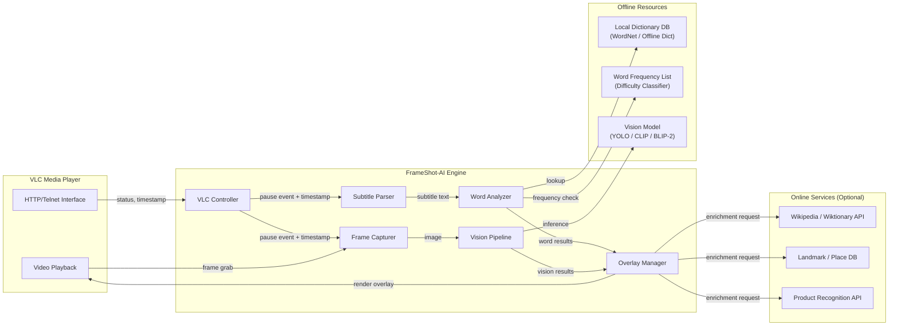
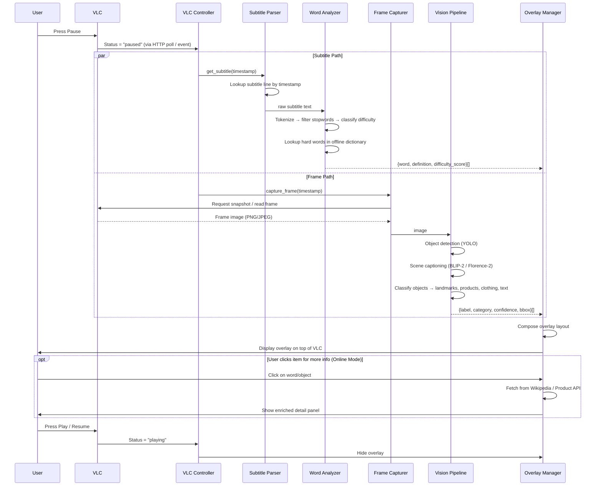
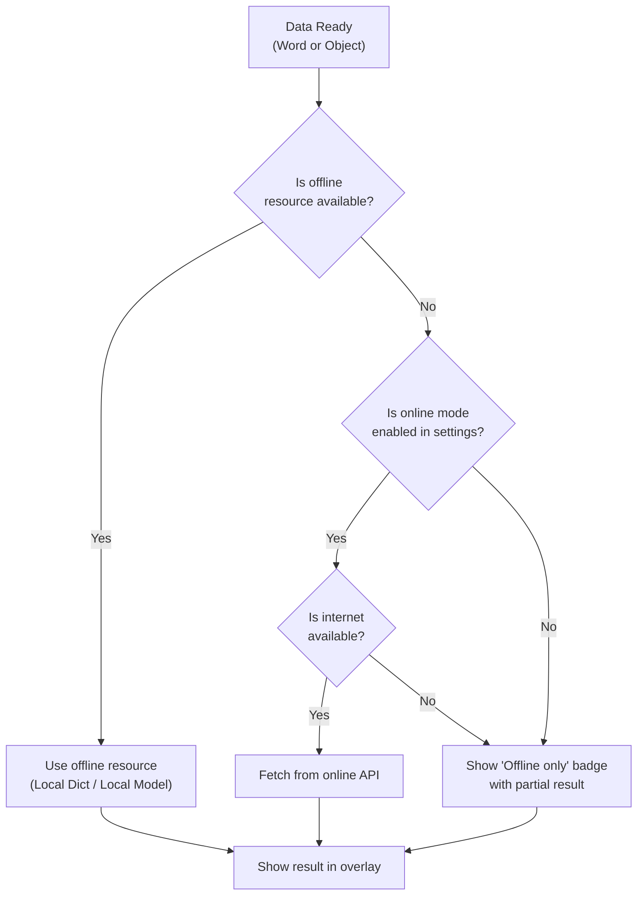
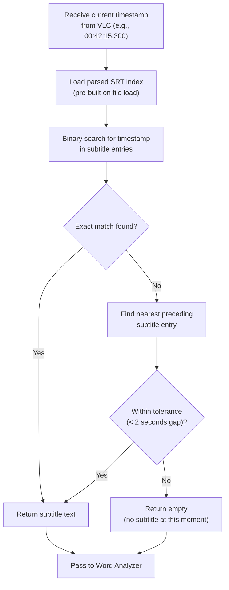
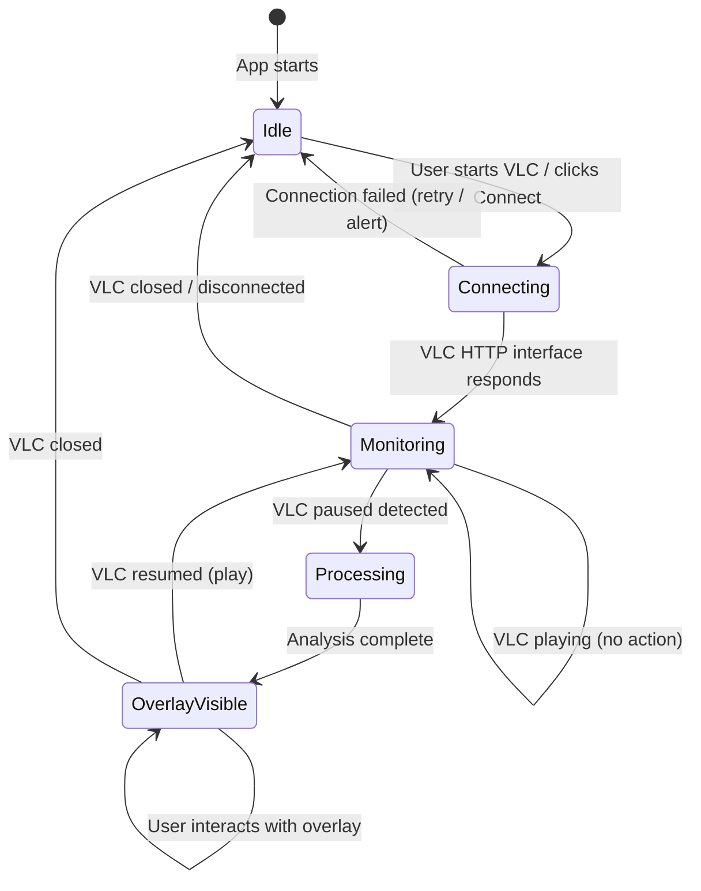

# 🔄 FrameShot-AI — Application Flow

## 1. High-Level User Flow

---

## 2. System Data Flow

---

## 3. Detailed Flow — Pause Event Handling

---

## 4. Offline vs. Online Decision Flow

---

## 5. Subtitle Timestamp Matching Flow

---

## 6. State Machine — Application States

